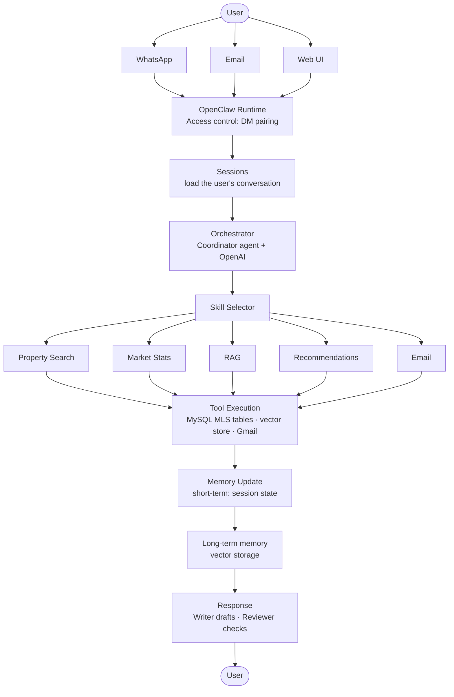

# Architecture: WhatsApp → OpenClaw → MLS Databases

**Week 1 deliverable** · IDX Exchange · OpenClaw 2026.9.5

This document describes how a user's question flows from a channel (WhatsApp, email, web) through OpenClaw's orchestrator and skills to the MLS databases and back.

---

## 1. Workflow diagram

```
User → WhatsApp → OpenClaw Runtime → Skill Selector → Tool Execution → Memory Update → Response → User
```



---

## 2. Core concepts

### Channels
Communication interfaces between users and OpenClaw.

| Channel | Purpose | Status |
|---|---|---|
| **WhatsApp** | Primary chat interface; OpenClaw is linked as a WhatsApp device via QR code. | Verified: send and receive |
| **Email** | Receive questions and send reports/alerts by email. Uses `EMAIL_USER` / `EMAIL_PASSWORD` from `.env`. | Planned |
| **Web** | OpenClaw Control UI (`http://127.0.0.1:18789/`) for chatting and inspecting sessions. | Available locally |

### Sessions
Each user gets their own session holding the conversation history and current state (filters they've applied, last results). This lets follow-ups like "what about Los Angeles?" work. OpenClaw keys sessions per agent and per sender (e.g. `agent:coordinator:main`). **Verified** in the dashboard.

### Orchestrator
The **Coordinator** agent ("Chief of Staff") receives every message, interprets intent with the LLM, and routes it to the right skill or specialist agent. The **Researcher** gathers data, the **Writer** drafts the answer, and the **Reviewer** checks it before sending. **Agents verified; routing rules planned.**

### Skills
Modular capability units. The Skill Selector picks one or more per request.

| Skill | What it does | Data source |
|---|---|---|
| **Property Search** | Finds listings matching filters (location, price, beds, baths, type, status). | MySQL MLS tables |
| **Market Stats** | Aggregates trends: median price, inventory, days on market, price per sq ft. | MySQL MLS tables |
| **RAG** | Answers questions from documents (listing descriptions, market reports, guides) by retrieving relevant passages before generating. | Vector store |
| **Recommendations** | Suggests properties based on the user's stated preferences and past searches. | MySQL + long-term memory |
| **Email** | Sends results, saved searches, or alerts to the user by email. | Gmail SMTP |

---

## 3. Week 1 status

| Item | Status |
|---|---|
| OpenClaw installed (built from source with pnpm) | Done |
| Agent team: Coordinator, Researcher, Writer, Reviewer on `gpt-6-luna` | Done |
| Gateway running as background service | Done |
| WhatsApp linked; agent sends and receives messages | Done |
| Both MLS datasets imported into MySQL and verified | Done |
| API keys in `.env`, gitignored | Done |
| Architecture documentation | This document |
